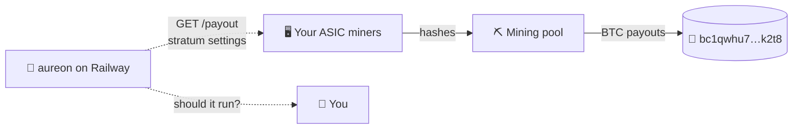

<div align="center">

# ⚡ aureon

**Should this miner run? Find out before you plug it in.**

Mining math built around heat and surplus power, across Bitcoin, Bitcoin Cash, Litecoin, Dogecoin, Kaspa and Monero:
hashprice from chain data, merged mining, profit switching, fleet sizing capped at $3,000/day per chain,
and an honest *mine vs. just buy* check.


</div>

---

## ✨ What it does

| | |
|---|---|
| 🧮 **Hashprice from the chain** | BTC per TH/s per day from difficulty, subsidy and fees. No third-party price feed needed. |
| 🔥 **Heat is income** | If the miner replaces a heater, the heat it makes offsets the power bill. |
| ☀️ **Surplus-aware** | Solar or other spare power is costed at what exporting it would have earned, not the full tariff. |
| ⚖️ **Mine vs. buy** | Compares the BTC you'd mine with the BTC the same money would buy today. |
| 💸 **Capex ceiling** | The most you can pay per TH/s and still beat buying. |
| ⛓️ **Multi-chain** | Six proof-of-work chains, merged LTC+DOGE mining, BTC↔BCH profit switching, and staking yields for ETH, SOL, AVAX and ADA. |
| 🎯 **$3,000/day cap** | Sizes a fleet to reach, never exceed, $3,000 of revenue per chain per day, and says whether it's worth building. |
| 💾 **Fits on a flash drive** | The whole brain packs into one 18 KB file that runs anywhere Python does. |
| 🔒 **Hardened API** | Zero dependencies, strict input checks, rate limiting, non-root container. |

## 📊 Sample results

Inputs from the 2026-11-09 hashrate roundup: difficulty 148.36T, 0.0228 BTC average fees, BTC at $74,624.

| Scenario | Result |
|---|---|
| Hashprice | `0.000427` BTC/PH/day, within 0.2% of the published figure |
| S21 (234 TH, 3.5 kW) breakeven power price | **8.7¢/kWh** |
| S21 on 15¢ grid power, heat not used | 🔴 loses $5.33/day |
| S21 replacing a resistive heater | 🟢 runs; power cost fully offset |
| S21 replacing a heat pump (COP 3) | 🔴 loses; the heat pump makes heat 3× cheaper |
| New $3k S21, one 150-day heat season | 🔴 mines only 0.37× the BTC the $3k would buy |
| Used $500 S19, 300 days of free heat | 🟢 mines 1.78× the BTC the money would buy |

---

## 🚀 Quick start

```bash
git clone https://github.com/shep95/aureon-miner.git && cd aureon-miner
```

```bash
python app.py
```

```bash
curl localhost:8000/payout
```

No `pip install` needed to run it. The server uses only the Python standard library.

### As a library

```python
from aureon_core import Machine, Site, hashprice_btc_per_th_day, daily_ledger

hp   = hashprice_btc_per_th_day(difficulty=148.36e12, subsidy_btc=3.125, avg_fees_btc=0.0228)
s21  = Machine(th=234, watts=3510, capex_usd=3000)
home = Site(tariff_usd_kwh=0.15, heat_credit_usd_kwh=0.15, heat_fraction_used=1.0)

daily_ledger(s21, home, hp, btc_usd=74_624)
# {'run': True, 'net_usd': 7.30, 'sats_day': 9787.8, ...}
```

---

## 🚂 Deploy on Railway

1. **New Project → Deploy from GitHub repo** → pick `aureon-miner`.
2. Railway reads `railway.json`, builds the `Dockerfile`, and watches `/health`.
3. **Settings → Networking → Generate Domain.**
4. Open `https://<your-domain>/payout`.

Nothing else is required. `PORT` is set by Railway.

### ⚙️ Environment variables

| Variable | Default | Purpose |
|---|---|---|
| `PAYOUT_ADDRESS` | `bc1qwhu7…k2t8` | Where Bitcoin rewards go. Checksum-validated; the app **won't start** if it's invalid. |
| `PAYOUT_ADDRESS_BCH` / `_LTC` / `_DOGE` / `_KAS` / `_XMR` | unset | One per chain, each checksum-validated in its own format. There's no fallback: a BTC address is never used for another chain. |
| `MAX_CAP_USD_DAY` | `3000` | Revenue ceiling per chain per day. It can be lowered, never raised above 3,000. |
| `RATE_LIMIT_PER_MIN` | `120` | Requests per client per minute (`0` turns it off). |
| `MAX_CONNECTIONS` | `64` | Concurrent connections before new ones are refused. |
| `TRUST_PROXY` | `1` | Use the proxy's `X-Forwarded-For` entry to identify clients. Set to `0` if not behind a proxy. |

---

## 💰 How payouts work

> [!IMPORTANT]
> **This app never holds, receives or sends bitcoin.** It does the math and tells your miners where to send rewards.
> Running it on Railway mines nothing; Railway's servers aren't mining hardware.



Rewards only flow when real mining hardware is pointed at a pool. `GET /payout` returns the settings to enter on each machine:

| Pool type | What to enter |
|---|---|
| **Address as username**: Ocean, solo.ckpool | user `bc1qwhu7xz88spa56mfvmg0zhtwlr4sny0qel2k2t8.worker1`, password `x` |
| **Account-based**: Braiins, F2Pool, AntPool | Your account name as the user; set the address above as the payout address in the pool dashboard. |

---

## 🔌 API

All `POST` bodies are JSON. Anywhere a hashprice is needed you can send either
`"hashprice_btc_th_day": <number>` or `"chain": {difficulty, subsidy_btc, avg_fees_btc}`.

| Method | Path | Body | Returns |
|---|---|---|---|
| `GET` | `/health` | n/a | status and route list |
| `GET` | `/payout` | n/a | payout addresses and stratum settings for every configured chain |
| `GET` | `/chains` | n/a | supported chains, snapshot data, which have payout addresses |
| `POST` | `/plan` | `tariff_usd_kwh, cap_usd_day?, horizon_days?, chains?, stake?` | fleet size, cost and verdict per chain, up to $3,000/day |
| `POST` | `/hashprice` | `difficulty, subsidy_btc, avg_fees_btc` | BTC per TH/s per day |
| `POST` | `/ledger` | `machine, site, chain, btc_usd` | daily kWh, sats, revenue, costs, net, run? |
| `POST` | `/breakeven` | `machine, chain, btc_usd, pool_fee?` | highest power price that still breaks even |
| `POST` | `/mine-vs-buy` | `machine, site, chain, btc_usd, run_days, monthly_hashprice_decay?` | mined vs. bought BTC |
| `POST` | `/max-capex` | `chain, btc_usd, run_days, pool_fee?, monthly_hashprice_decay?` | max $ per TH/s |

<details>
<summary><b>Example request</b></summary>

```bash
curl -s -X POST localhost:8000/mine-vs-buy \
  -H 'Content-Type: application/json' \
  -d '{
    "machine": {"th": 95, "watts": 3250, "capex_usd": 500},
    "site":    {"tariff_usd_kwh": 0.15, "heat_credit_usd_kwh": 0.15, "heat_fraction_used": 1},
    "chain":   {"difficulty": 148.36e12, "subsidy_btc": 3.125, "avg_fees_btc": 0.0228},
    "btc_usd": 74624,
    "run_days": 300
  }'
```

```json
{
  "mined_btc": 0.01192,
  "bought_btc": 0.00670,
  "mining_wins": true,
  "ratio": 1.779,
  "payout_address": "bc1qwhu7xz88spa56mfvmg0zhtwlr4sny0qel2k2t8"
}
```
</details>

<details>
<summary><b>Field reference</b></summary>

**`machine`** (all required)

| Field | Meaning |
|---|---|
| `th` | Measured accepted hashrate, TH/s |
| `watts` | Measured wall power |
| `capex_usd` | All-in cost: machine, wiring, ducting, shipping |

**`site`** (all optional)

| Field | Default | Meaning |
|---|---|---|
| `tariff_usd_kwh` | `0` | Marginal price of the next kWh |
| `heat_credit_usd_kwh` | `0` | Cost of 1 kWh of heat from the system being replaced: resistive `tariff`, heat pump `tariff / COP`, gas `fuel price / furnace efficiency` |
| `heat_fraction_used` | `0` | Share of miner heat that actually replaces heating (0–1) |
| `surplus_kwh_day` | `0` | Solar or other surplus available per day |
| `export_credit_usd_kwh` | `0` | What that surplus would earn if exported |
| `pool_fee` | `0.02` | Pool fee (0–0.99) |
| `wear_usd_day` | `0` | Maintenance and depreciation per day |
</details>

---

## 🛡️ Security

| Protection | Detail |
|---|---|
| **Strict input checks** | Numbers must be finite and in range. Strings, booleans, unknown fields, `NaN` and `Infinity` are rejected with `400`. |
| **Size limits** | 16 KB maximum body; `run_days` capped at 3,650. |
| **Slow-client protection** | 10 s socket timeout; concurrent connections capped. |
| **Rate limiting** | Per client, keyed on the proxy-added address so it can't be dodged with a fake header. |
| **No internal details leaked** | Unexpected errors return a generic `500`. The server header hides the Python version. Logs leave out request bodies and query strings. |
| **Hardened headers** | `nosniff`, `DENY` framing, `no-referrer`, a locked-down CSP, `no-store`. |
| **Container** | `python:3.12-slim`, runs as uid `10001`, read-only app files, built-in health check. |
| **Payout safety** | Every chain's address is checksum-validated at startup (bech32/m, cashaddr, base58check, Monero Keccak). A typo or another chain's address stops the deploy instead of sending rewards nowhere. |
| **Supply chain** | Zero runtime dependencies. |

> [!NOTE]
> The rate limiter is in-memory and per instance. If you scale to several replicas, each one counts separately.
> The API has no authentication because it only does math on the inputs you send and holds no secrets.

---

## ⛓️ Multi-chain planner

```bash
curl -s -X POST localhost:8000/plan -H 'Content-Type: application/json' -d '{"tariff_usd_kwh": 0.05}'
```

For each chain, sizes the fleet that brings in up to **$3,000/day** (the hard maximum; requests above it get `400`),
then runs a year day by day with difficulty growth, scheduled emission cuts and run/idle decisions.

**At 5¢/kWh industrial power, mid-November 2026 prices:**

| Chain | Hardware | Machines for $3k/day | Hardware cost | Power draw | Net/day today | Verdict |
|---|---|---|---|---|---|---|
| Bitcoin (↔ BCH) | Antminer S21 | 410 | $1.23M | 1.4 MW | +$1,268 | 🔴 doesn't repay in a year (halving 2028) |
| Litecoin + Dogecoin | Antminer L9 | 486 | $2.19M | 1.6 MW | +$1,038 | 🔴 doesn't repay in a year |
| Kaspa | Antminer KS7 | 533 | $1.33M | 1.6 MW | +$1,025 | 🔴 emission halves yearly; idle by month 6 |
| Monero | Ryzen 9 7950X rigs | 3,779 | $5.67M | 0.7 MW | +$2,183 | 🔴 doesn't repay in a year |

| Staking | Yield | Capital for $3k/day |
|---|---|---|
| Avalanche | 6.7% | $16.4M |
| Solana | 5.8% | $18.9M |
| Ethereum | 2.8% | $39.1M |
| Cardano | 2.2% | $49.1M |

> [!WARNING]
> Revenue scales with hardware and electricity, and with capital for staking. Software can't create hashrate:
> proof-of-work exists precisely so that it can't be faked. What aureon does is make every machine count:
> run only when it pays, mine two coins at once where possible, and switch to the chain that pays more.

Prices, hashrates and rewards are a snapshot; override any of them per request:
`"chains": {"KAS": {"price_usd": 0.05}}`, `"stake": {"ETH": {"apr": 0.03}}`.

## 📈 Income simulation

```bash
python simulate.py
```

Runs every setup through 24 months, day by day: hashprice recomputed from growing difficulty,
the April 2028 halving, bear/base/bull BTC prices, and heating seasons. Each day the miner runs
only if aureon says it pays. `--json` gives the full monthly breakdown.

| Setup (base market) | Runs | Cash P/L | vs buying BTC |
|---|---|---|---|
| S21 on 15¢ grid, always on | 100% | 🔴 −$8,479 | 0.30× |
| S21 on 15¢ grid, following aureon | 0% | stays off; don't buy it | n/a |
| S21 heating a home | 45% | 🔴 −$1,389 | 0.58× |
| **Used $500 S19 heating a home** | 38% | 🟢 **+$81** | **1.13×** |
| S21 on solar surplus | 40% | 🔴 −$2,822 | 0.41× |
| 10× used S21 at 5¢ | 60% | 🔴 −$11,832 | 0.66× |

The result is consistent: at today's hashprice, **only cheap used hardware whose power cost is covered by heat
beats buying bitcoin**, and it earns a few dollars a month, not a living. The aureon server itself mines nothing.

## 💾 Run it from a flash drive

```bash
./build_portable.sh
```

Produces `dist/aureon.pyz`, the entire brain in one 18 KB file. Copy it to a USB stick and run it on any machine with Python 3.10+:

```bash
python aureon.pyz
```

```bash
python aureon.pyz plan 0.05
```

```bash
python aureon.pyz simulate
```

The drive carries the decisions; the mining machines on the network do the hashing.

## 🧪 Development

```bash
pip install pytest
```

```bash
pytest -q
```

105 tests: the core math checked against published figures, every endpoint, hostile inputs
(bad JSON, `NaN`, oversized bodies, negative `Content-Length`), rate limits, the connection cap, the simulator, and the multi-chain engine: published address vectors for every chain,
single-typo and wrong-chain rejection, merged mining, profit switching, Kaspa's emission curve, and the $3,000 cap.
CI runs them on Python 3.10, 3.12 and 3.13, then builds the container and smoke-tests it.

```
aureon_core.py   pure decision math, no I/O
payout.py        bech32 address validation and stratum settings
app.py           hardened stdlib HTTP API
simulate.py      day-by-day 24-month income simulation
chains.py        multi-chain revenue, merged mining, profit switching, fleet sizing
addresses.py     payout address checksums: bech32, cashaddr, base58check, monero keccak
build_portable.sh  packs everything into one 18 KB aureon.pyz
Dockerfile       non-root runtime image
railway.json     Railway build, health check and restart policy
```

<div align="center">
<sub>Money values are USD floats for illustration. A production ledger should store integer sats.</sub>
</div>
